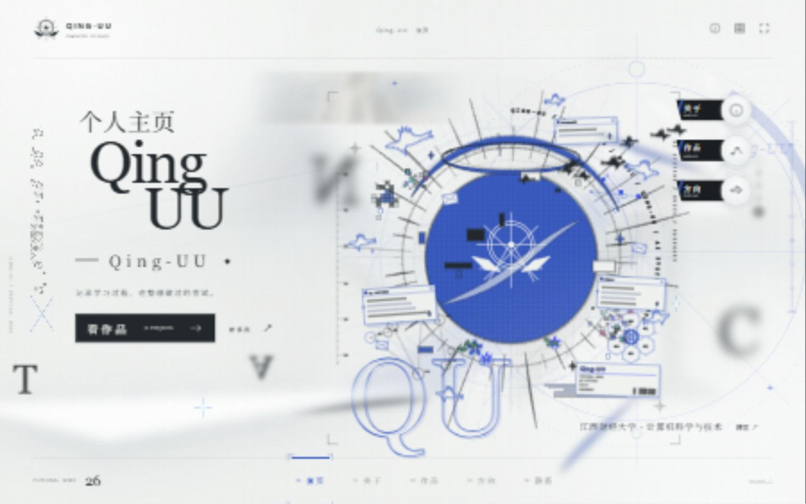

# Qing-UU // Personal Node

Qing-UU 的个人主页：学习记录、代码、音乐和硬件项目。



## 打开

双击 `双击打开.html`，或运行本地服务：

```powershell
npm ci
npm run build
npm start
```

开发时运行 `npm run dev`。

- `/`、`/personal.html`：作品集。
- `/archive.html`：原版互动图录。
- `个人网站样例.html`：同一作品集的另一个离线入口。

## 内容

重点展示 MCMer、Dialograph、Pianalysis、Decision Arena、旋律标注工具和 ESP32 GIF Player。日记日历只出现在关于页的次要链接中。

资料来自 [GitHub 主页](https://github.com/qinghuan-yu/qinghuan-yu) 及各公开项目的 README。姓名、简介、项目和外链统一在 `src/site/profile.ts` 中修改。项目详情中的图版展示各项目的处理流程。

## 页面

- 首页：姓名、简短介绍和作品入口。
- 关于：个人介绍与学习方向。
- 作品：拖动地图、点选项目、查看说明与源码。
- 方向：每个条目关联具体项目。
- 联系：GitHub 和博客链接。

支持 `#/works/pianalysis`、`#/about`、`#/skills`、`#/contact` 深链。`?still` 可用于静态截图检查。

## 检查

```powershell
npm test
npm run build
npm run verify
```

Cloudflare Pages 沿用 `profile` 项目，构建命令为 `npm run build:cloudflare`，输出目录为 `out`。生产域名为 `https://info.reliarc.com`。

技术栈：TypeScript、Vite、SVG、Canvas；原版圣堂使用 Three.js。

改造与验证记录见 [docs/portfolio-validation.md](docs/portfolio-validation.md)。原图录说明保存在 [docs/original-guide.md](docs/original-guide.md)，素材来源和第三方组件说明见 [THIRD_PARTY_NOTICES.txt](THIRD_PARTY_NOTICES.txt)。
